# CAPSTONE-PBO-KELOMPOK-25

## 1. Nama Program

**Feedback FIBER - Sistem Informasi Pengelolaan Feedback dan Kepuasan Pelanggan FIBER**

## 2. Deskripsi Singkat

Feedback FIBER merupakan aplikasi desktop berbasis Java yang digunakan untuk membantu pengelolaan masukan dan penilaian kepuasan pelanggan terhadap layanan FIBER. Melalui aplikasi ini, pengguna dapat memberikan review, memberikan upvote pada review, serta mengisi kuesioner kepuasan dengan skala penilaian 1 sampai 5.

Aplikasi menyediakan dua jenis hak akses, yaitu **User** dan **Admin**. User dapat mengirimkan feedback dan mengisi kuesioner, sedangkan Admin dapat mengelola review serta membuat dan mengelola kuesioner. Data aplikasi disimpan ke dalam database sehingga dapat dikelola dan ditampilkan kembali sesuai kebutuhan.

## 3. Fitur Utama Program

### 3.1 Splash Screen dan Loading
- Menampilkan halaman pembuka sebelum pengguna masuk ke aplikasi.
- Melanjutkan proses ke halaman login setelah loading selesai.

### 3.2 Login
- Pengguna dapat masuk menggunakan akun FIBER, alamat email, atau nomor telepon.
- Sistem memeriksa identitas dan password sebelum memberikan akses.
- Sistem mengarahkan pengguna ke halaman sesuai role, yaitu User atau Admin.

### 3.3 Registrasi Akun
- Pengguna dapat membuat akun baru.
- Data yang diisi meliputi nama, tanggal lahir, gender, domisili, password, serta identitas akun.
- Registrasi mendukung pilihan identitas berupa akun FIBER, email, atau nomor telepon.
- Data wilayah seperti provinsi, kabupaten/kota, dan kecamatan dapat dipilih melalui layanan API wilayah Indonesia.
- Sistem melakukan validasi data dan memeriksa identitas agar tidak digunakan oleh akun lain.

### 3.4 Menu User
- Menampilkan halaman utama pengguna dan informasi profil.
- Menyediakan fitur untuk menulis dan mengirim review.
- Pengguna dapat memilih untuk mengirim review dengan nama atau secara anonim.
- Menyediakan fitur melihat review dan memberikan upvote.
- Pengguna dapat mengisi kuesioner kepuasan yang tersedia.
- Menampilkan histori feedback dan histori pengisian kuesioner milik pengguna.

### 3.5 Menu Admin
- Menampilkan halaman utama Admin.
- Admin dapat melihat dan mengelola review yang dikirim oleh pengguna.
- Admin dapat menghapus review sesuai kebutuhan pengelolaan.
- Admin dapat membuat, melihat, dan mengubah kuesioner beserta pertanyaannya.
- Menyediakan pencatatan aktivitas Admin selama sesi berlangsung.

### 3.6 Review dan Upvote
- Review disimpan ke database dan ditampilkan kepada pengguna.
- Pengguna dapat mengirim review secara anonim.
- Pengguna dapat memberikan upvote pada review.
- Pengguna dapat membatalkan upvote yang sebelumnya diberikan.
- Sistem memeriksa agar pengguna dapat mengetahui apakah review sudah pernah di-upvote.

### 3.7 Kuesioner Kepuasan
- Admin dapat membuat kuesioner yang berisi judul, deskripsi, dan daftar pertanyaan.
- Pengguna dapat memilih jawaban menggunakan skala 1-5, mulai dari **Sangat Tidak Puas** sampai **Sangat Puas**.
- Sistem menyimpan jawaban beserta tanggal pengisian.
- Pengguna dapat melihat histori kuesioner yang pernah diisi, termasuk jumlah jawaban dan nilai rata-rata.

### 3.8 Profil dan Logout
- Pengguna dapat melihat informasi akun dan domisili.
- Pengguna dapat mengakhiri sesi melalui tombol logout.
- Setelah logout, aplikasi mengarahkan pengguna kembali ke halaman login.

## 4. Tech Stack

| Komponen | Teknologi | Kegunaan |
|---|---|---|
| Bahasa pemrograman | Java 21 | Mengembangkan logika dan fitur aplikasi. |
| Database | MySQL/MariaDB | Menyimpan data akun, review, upvote, kuesioner, pertanyaan, dan jawaban. |
| Koneksi database | JDBC | Menghubungkan aplikasi Java dengan database dan menjalankan perintah SQL. |
| Database driver | MariaDB Java Client dan MySQL Connector/J | Menyediakan driver agar aplikasi dapat terhubung ke database. |
| GUI | Java Swing | Membuat tampilan desktop seperti login, registrasi, menu, tabel, dan dialog. |
| Build tool | Apache Maven | Mengatur dependensi dan proses build aplikasi. |
| JSON library | Jackson Databind | Membaca dan mengolah respons JSON dari API wilayah. |
| API eksternal | https://wilayah.web.id/api | Mengambil data provinsi, kabupaten/kota, dan kecamatan di Indonesia. |
| Java API | Java Time, Java HTTP Client, SwingWorker | Mengelola tanggal/waktu, permintaan HTTP, dan proses latar belakang pada GUI. |
| API eksternal | https://github.com/LGoodDatePicker/LGoodDatePicker | Mengambil nilai tanggal dalam bentul kalender. |


## 5. Perancangan Sistem

Bagian ini berisi dokumentasi rancangan sistem Feedback FIBER.

### 5.1 Flowchart

Flowchart digunakan untuk menjelaskan alur proses aplikasi dari awal dijalankan sampai fitur digunakan oleh User maupun Admin.

<details>
   
<summary><b>Flowchart Registrasi</b></summary>

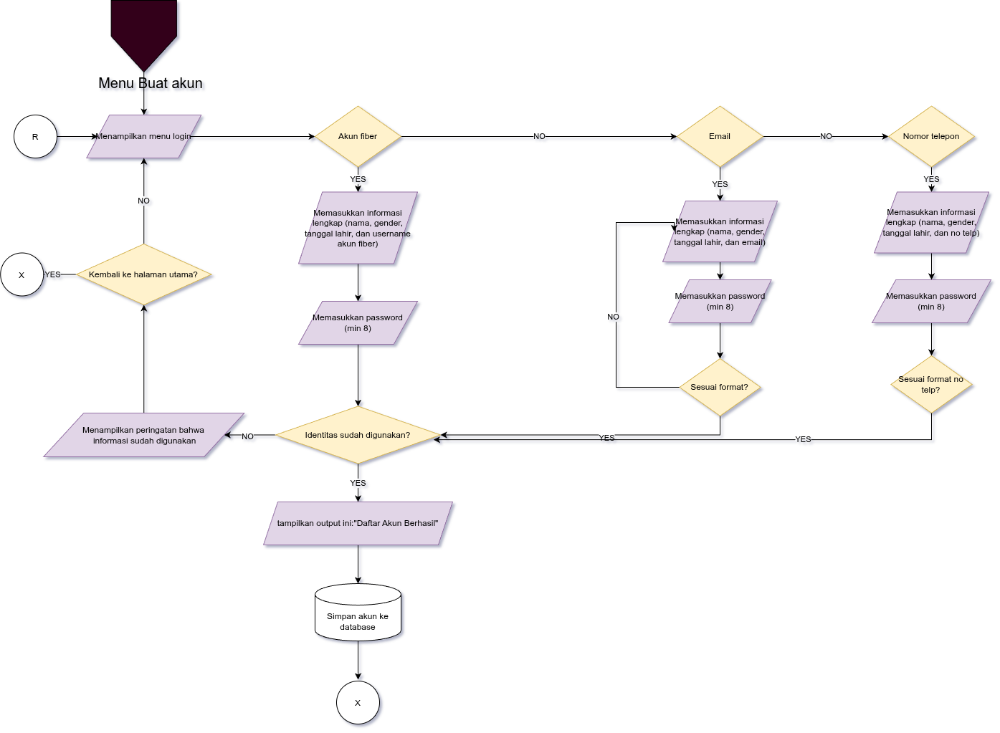

</details>

<details>
<summary><b>Flowchart Login</b></summary>

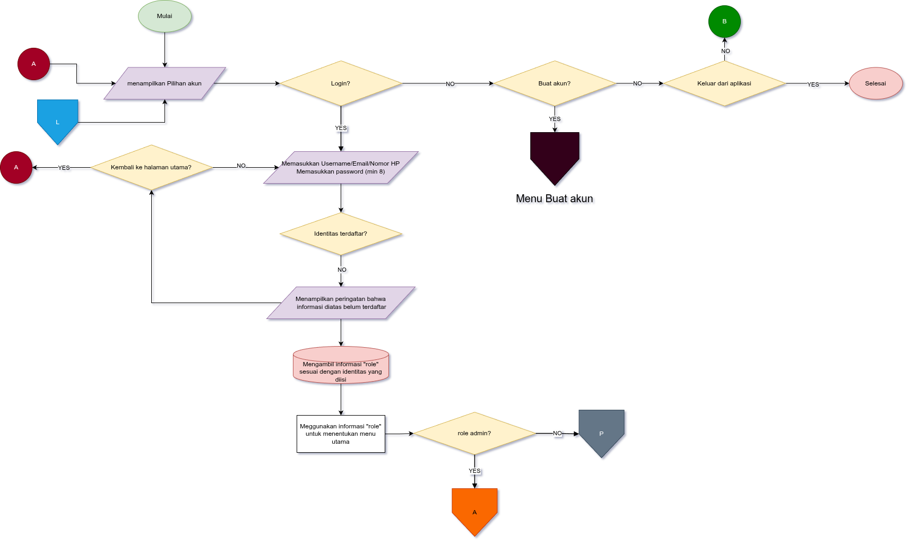

</details>

<details>
<summary><b>Flowchart Admin</b></summary>

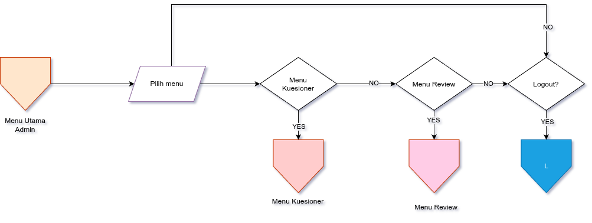

</details>

<details>
<summary><b>Flowchart Review</b></summary>

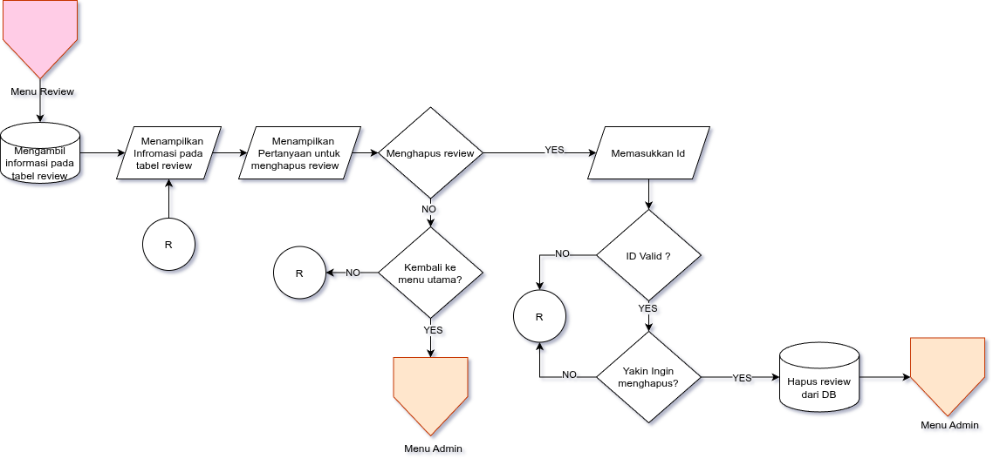

</details>

<details>
<summary><b>Flowchart Kuesioner Admin</b></summary>

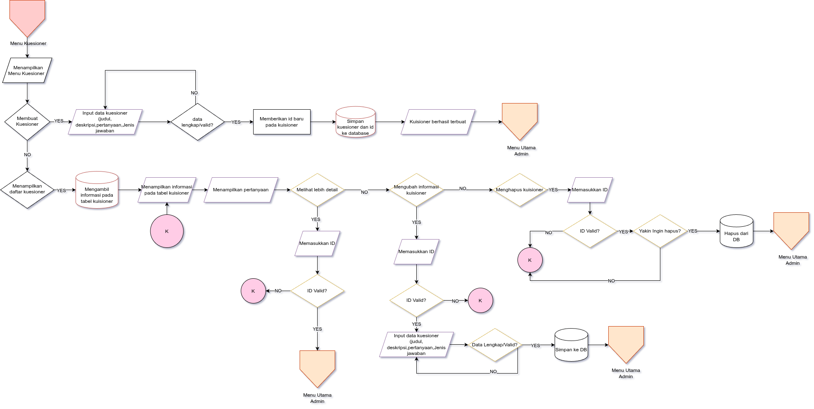

</details>

<details>
<summary><b>Menu Pelanggan</b></summary>

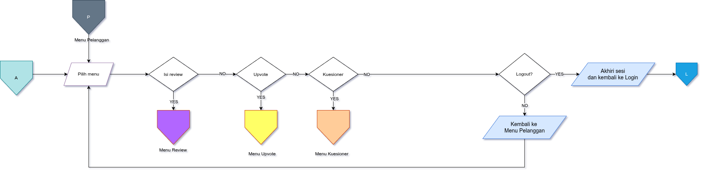

</details>

<details>
<summary><b>Menu Upvote Pelanggan</b></summary>

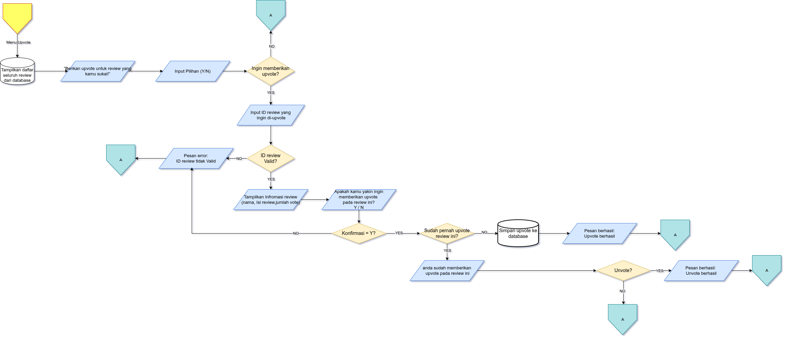

</details>

<details>
<summary><b>Menu Kuesioner Pelanggan</b></summary>

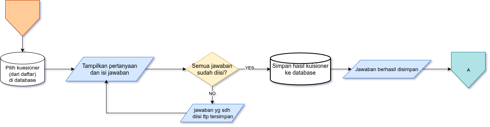

</details>


<details>
<summary><b>Menu Review Pelanggan</b></summary>

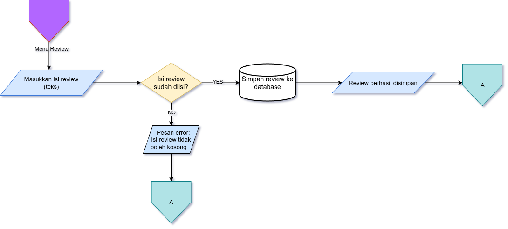
</details>

### 5.2 Use Case Diagram

Use Case Diagram menggambarkan hubungan antara aktor dengan fitur yang tersedia pada aplikasi.

Aktor pada aplikasi Feedback FIBER terdiri dari:

- **User:** melakukan registrasi dan login, melihat profil, mengirim review, memilih mode anonim, melihat review, memberikan atau membatalkan upvote, mengisi kuesioner, serta melihat histori feedback.
- **Admin:** login, melihat dan mengelola review, menghapus review, membuat dan mengubah kuesioner, serta melihat aktivitas pengelolaan.

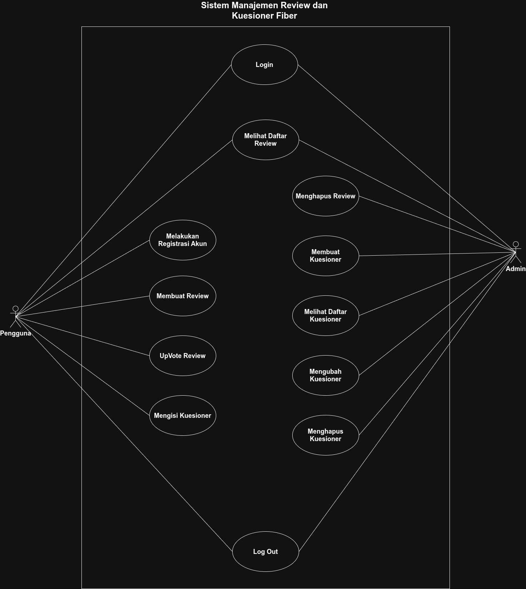

### 5.3 Entity Relationship Diagram (ERD)

ERD menggambarkan hubungan antarentitas yang digunakan untuk menyimpan data aplikasi Feedback FIBER. Diagram ERD disesuaikan dengan struktur database yang digunakan pada project.

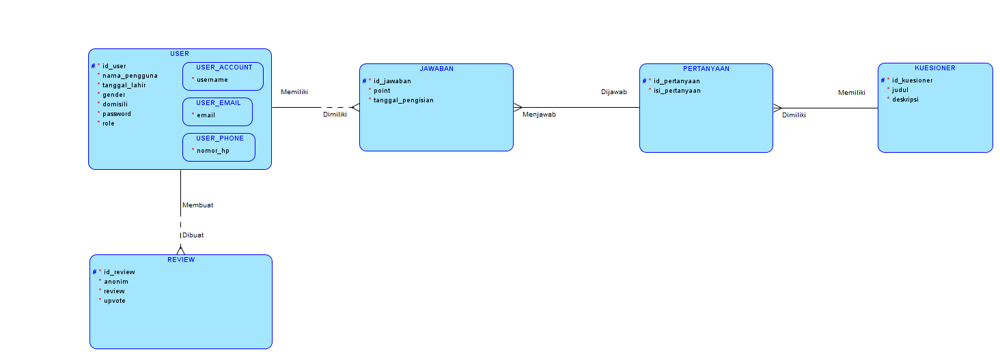


## 6. Struktur Folder/Package

```
FeedbackFIBER/
│
├── pom.xml
│
└── src/
    └── main/
        └── java/
            └── com/mycompany/feedbackfiber/
                │
                ├── Main.java
                │
                ├── config/
                │   └── Koneksi.java
                ...
                └── view/
                    ├── LoadingScreen.java / .form
                    ...
                    └── UI.java / .form
```

Project dibuat menggunakan Java dengan struktur package ...

Project dibuat menggunakan Java dengan struktur package untuk memisahkan bagian tampilan, pengendali proses, model data, dan konfigurasi koneksi database.

Penjelasan Struktur Packages
gatau cara upload gambar 

### Penjelasan Package

1. **Main**  
   Merupakan titik awal program. Bagian ini mengatur tampilan awal, menampilkan loading screen, memeriksa koneksi database, kemudian membuka halaman login.

2. **config**  
   Berisi konfigurasi koneksi database. Class `Koneksi` digunakan untuk membuka koneksi aplikasi ke database.

3. **controller**  
   Berisi class yang mengatur alur proses antara tampilan dan model. Contohnya `AuthController` untuk login dan registrasi, `ReviewController` untuk proses review dan upvote, serta `KuesionerController` untuk proses kuesioner.

4. **model**  
   Berisi representasi data dan proses pengolahan data aplikasi. Contohnya `User`, `Review`, `Kuesioner`, `Pertanyaan`, `UserModel`, `ReviewModel`, dan `KuesionerModel`. Package ini juga berisi class pendukung seperti `Validator`, `IdGenerator`, dan `WilayahService`.

5. **view**  
   Berisi seluruh tampilan antarmuka aplikasi menggunakan Java Swing, seperti halaman login, registrasi, menu User, menu Admin, serta dialog review dan kuesioner.

## 7. Penerapan 4 Pilar OOP

### 7.1 Encapsulation

Encapsulation merupakan konsep membungkus data dan proses di dalam class serta mengatur akses terhadap data tersebut. Tujuannya agar data tidak dapat diubah secara sembarangan dari bagian program lain.

Pada Feedback FIBER, encapsulation diterapkan melalui penggunaan access modifier seperti `private` pada atribut dan objek pendukung. Contohnya pada controller yang menyimpan objek model sebagai atribut `private final`.

Contoh pada `ReviewController`:

```java
private final ReviewModel model = new ReviewModel();
```

Atribut `model` hanya dapat diakses secara langsung dari dalam class `ReviewController`. Bagian lain menggunakan method publik seperti `daftar()`, `kirim()`, `hapus()`, dan `upvote()` untuk menjalankan proses yang diperlukan.

### 7.2 Inheritance

Inheritance merupakan konsep pewarisan atribut dan method dari class induk (parent) kepada class turunan (child). Pada Feedback FIBER, penerapan inheritance terlihat pada class tampilan yang mewarisi class bawaan Java Swing.

Contohnya:

```java
public class LoginView extends javax.swing.JFrame {
    // Komponen dan proses halaman login
}
```

Class `LoginView` mewarisi kemampuan dari `JFrame`, sehingga dapat menggunakan fitur dasar jendela aplikasi seperti pengaturan ukuran, judul, dan visibilitas.

Contoh lainnya adalah class `KuesionerUserDialog` yang mewarisi `JDialog`:

```java
public class KuesionerUserDialog extends javax.swing.JDialog {
    // Tampilan pengisian kuesioner
}
```

Dengan inheritance, class tampilan dapat menggunakan kembali kemampuan dari class induknya tanpa harus membuat seluruh fungsi jendela dari awal.

### 7.3 Polymorphism

Polymorphism merupakan kemampuan suatu method untuk memiliki bentuk atau perilaku yang berbeda sesuai objek atau implementasinya.

Pada Feedback FIBER, penerapannya dapat dilihat dari penggunaan method overriding pada class yang mewarisi class Java Swing maupun class lain.

Contohnya pada class `Kuesioner`:

```java
@Override
public String toString() {
    return id + " - " + judul;
}
```

Method `toString()` menyesuaikan representasi objek `Kuesioner` agar dapat menampilkan ID dan judul kuesioner ketika objek dimasukkan ke komponen pilihan seperti `JComboBox`.

Contoh lainnya terdapat pada class `WilayahService.Wilayah` yang mengubah perilaku `toString()` agar nama wilayah yang ditampilkan pada pilihan wilayah.

### 7.4 Abstraction

Abstraction merupakan konsep menyederhanakan sistem dengan menampilkan fungsi yang diperlukan dan menyembunyikan detail proses di dalamnya.

Pada Feedback FIBER, abstraction diterapkan melalui pemisahan proses ke dalam class Controller dan Model. Contohnya, ketika pengguna mengirim review, tampilan cukup memanggil method `kirim()` dari `ReviewController`. Proses validasi, pengelolaan sesi, dan penyimpanan ke database ditangani oleh bagian terkait.

Contoh pemanggilan pada controller:

```java
public void kirim(String isi, boolean anonim) throws SQLException {
    model.insert(Session.user().id(), isi.trim(), anonim);
}
```

Dengan pemisahan tersebut, class tampilan tidak perlu mengetahui seluruh detail query SQL untuk menyimpan review.

## 8. Cara Penggunaan Program

### 8.1 Menjalankan Program

1. Pastikan Java Development Kit (JDK) 21 sudah terpasang.
2. Pastikan MySQL/MariaDB sudah berjalan.
3. Buat database dengan nama `feedback_fiber_program_db` dan siapkan tabel sesuai struktur database project.
4. Sesuaikan URL, username, dan password database pada file `Koneksi.java`.
5. Buka project melalui NetBeans atau IDE yang mendukung Maven.
6. Tunggu proses dependensi Maven selesai.
7. Jalankan class `Main.java`.

### 8.2 Splash Screen dan Loading

Saat aplikasi pertama kali dijalankan, sistem menampilkan splash screen dan loading sebelum membuka halaman login.

### 8.2 Splash Screen dan Loading

Saat aplikasi pertama kali dijalankan, sistem menampilkan splash screen dan loading sebelum membuka halaman login.

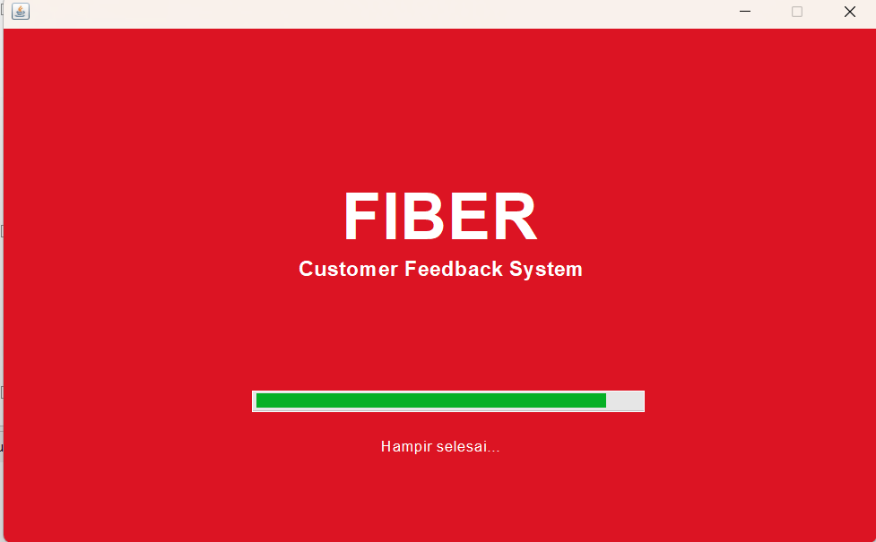


### 8.3 Halaman Login

Halaman login digunakan oleh User maupun Admin untuk masuk ke aplikasi. Pengguna dapat memasukkan identitas berupa akun FIBER, email, atau nomor telepon, kemudian memasukkan password.

Jika data sesuai, sistem akan mengarahkan pengguna ke menu berdasarkan role akun.

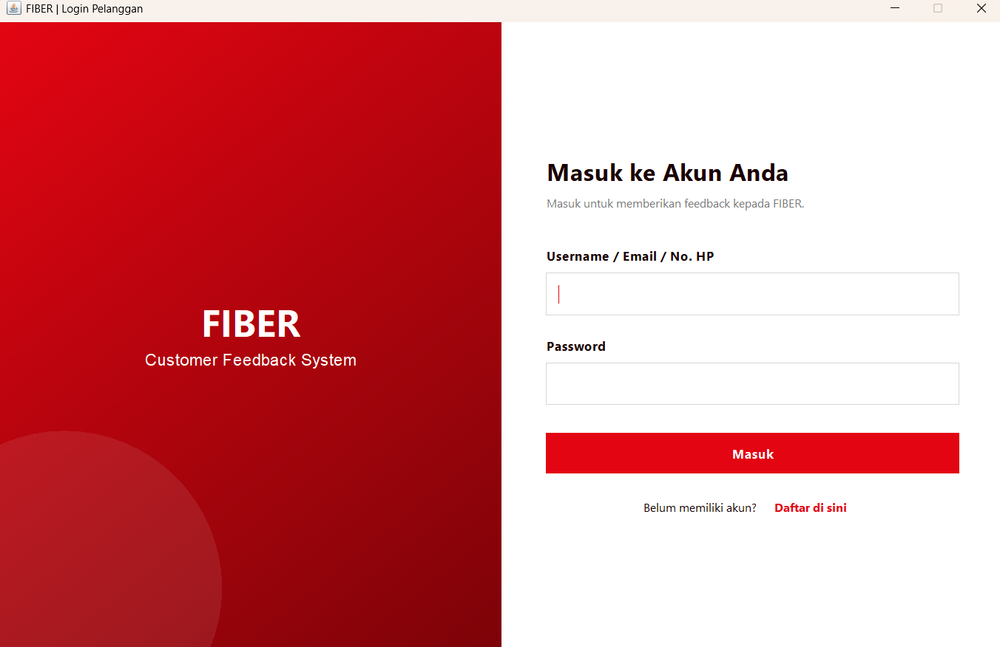

### 8.4 Halaman Registrasi

Pengguna yang belum memiliki akun dapat memilih menu registrasi. Pengguna mengisi data diri, tanggal lahir, gender, domisili, password, serta memilih jenis identitas yang akan digunakan, yaitu akun FIBER, email, atau nomor telepon.

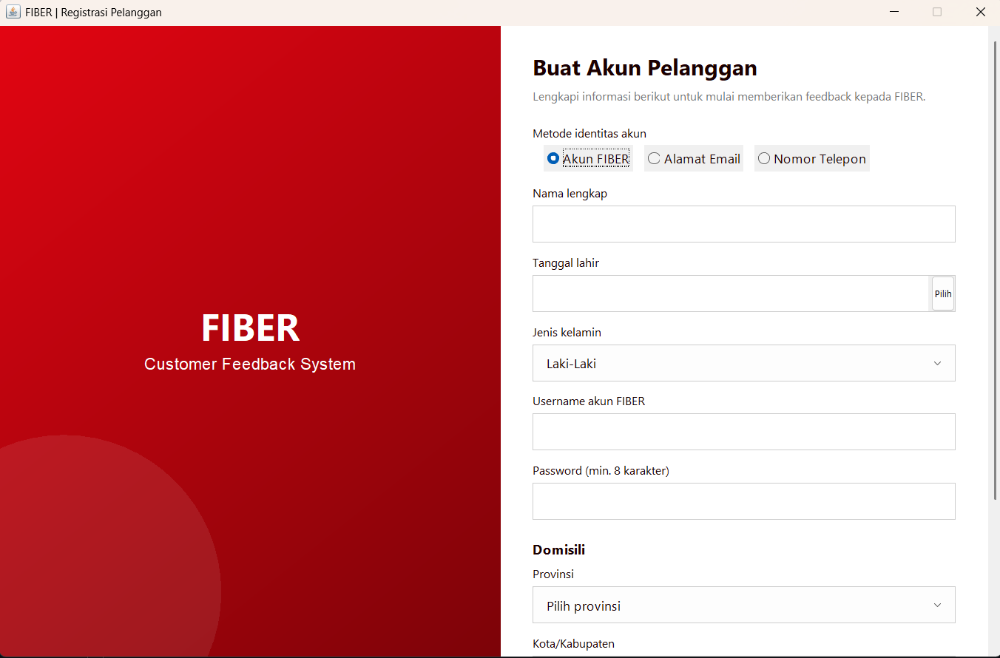

### 8.5 Menu User

Setelah berhasil login sebagai User, pengguna akan masuk ke halaman Menu User. Pada halaman ini tersedia akses menuju fitur review, upvote, kuesioner, dan profil.

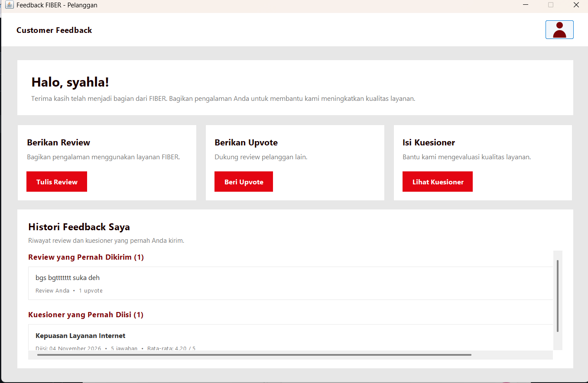

### 8.6 Mengirim Review

Pengguna dapat membuka fitur review dan menuliskan pendapat atau masukan mengenai layanan FIBER. Pengguna juga dapat memilih opsi anonim jika tidak ingin nama ditampilkan pada review.

Setelah review dikirim, sistem akan menyimpan data ke database.

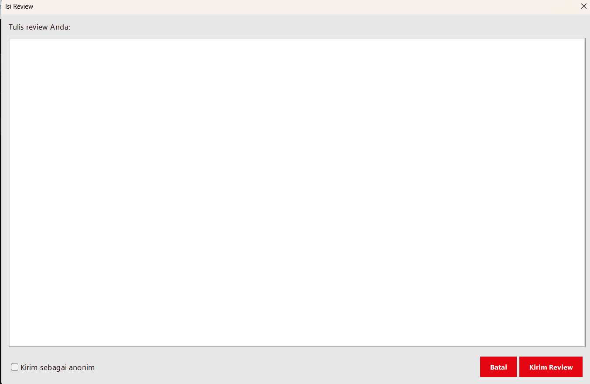

### 8.7 Melihat Review dan Memberikan Upvote

Pengguna dapat melihat review yang tersedia dan memberikan upvote sebagai bentuk dukungan terhadap review tertentu. Pengguna juga dapat membatalkan upvote yang telah diberikan.

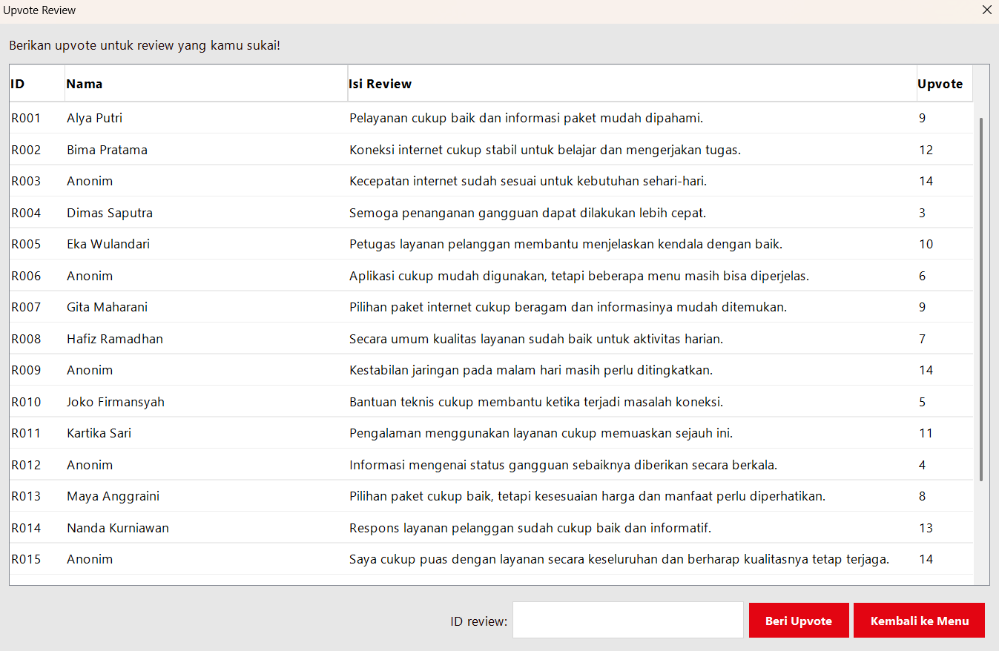

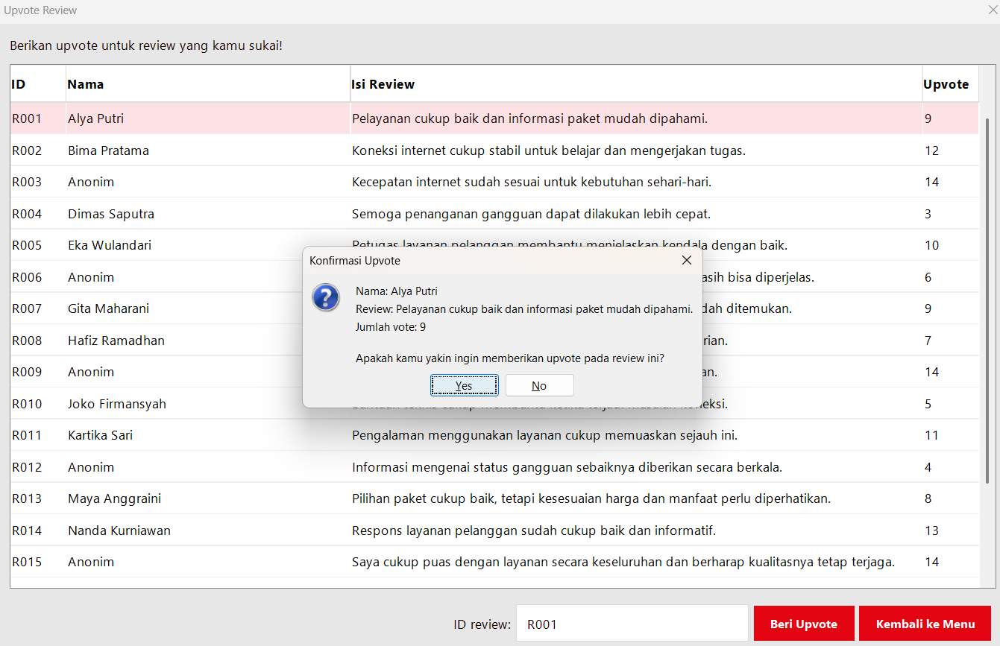

### 8.8 Mengisi Kuesioner

Pengguna dapat memilih kuesioner yang tersedia, membaca pertanyaan, kemudian memberikan penilaian menggunakan skala 1 sampai 5, yaitu:

- 1 Sangat Tidak Puas
- 2 Tidak Puas
- 3 Cukup
- 4 Puas
- 5 Sangat Puas

Setelah seluruh pertanyaan dijawab, pengguna dapat menyimpan jawaban.

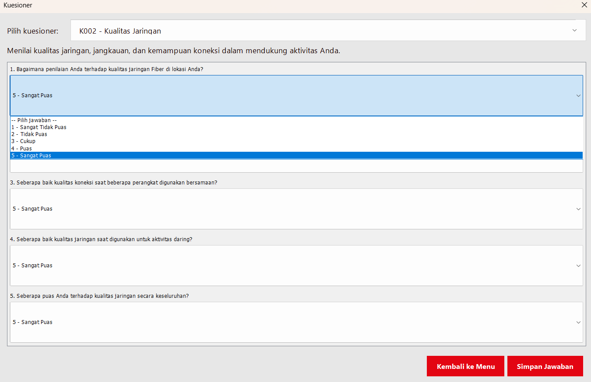

### 8.9 Melihat Histori Feedback

Pengguna dapat melihat histori review yang pernah dikirim serta histori pengisian kuesioner. Informasi histori kuesioner mencakup tanggal pengisian, jumlah jawaban, dan nilai rata-rata.

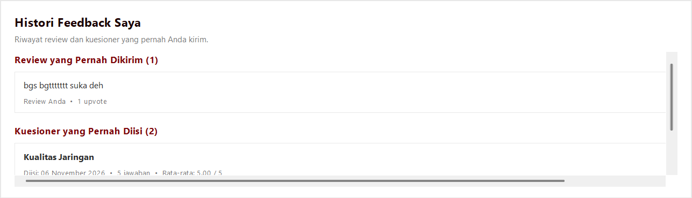

### 8.10 Menu Admin

Admin yang berhasil login akan diarahkan ke halaman Menu Admin. Menu ini menyediakan akses untuk mengelola review dan kuesioner.

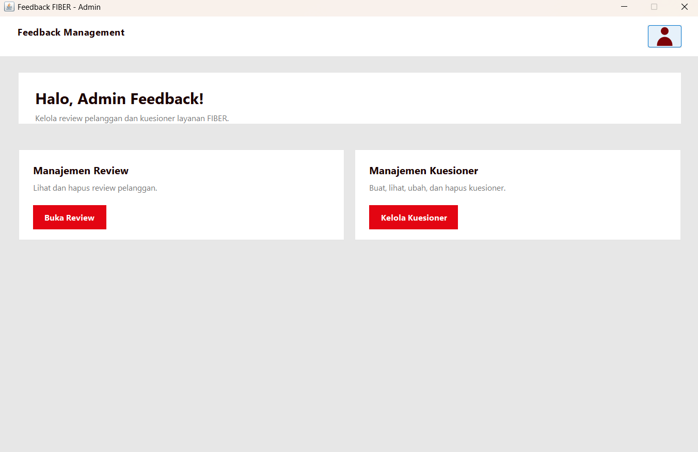

### 8.11 Mengelola Review

Admin dapat melihat review yang telah dikirim oleh pengguna dan menghapus review sesuai kebutuhan pengelolaan aplikasi.

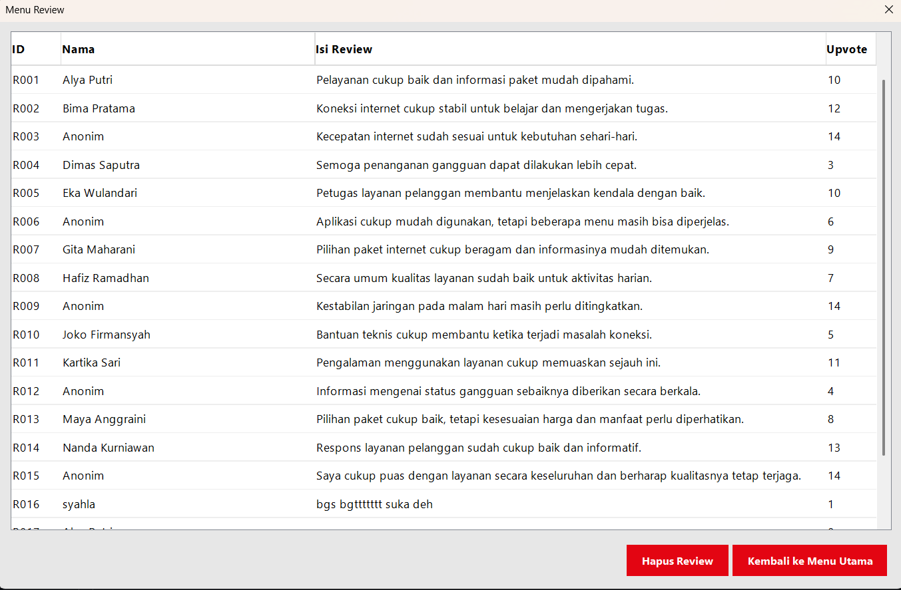

### 8.12 Hapus Review
Fitur ini digunakan Admin untuk menghapus review pelanggan yang sudah tidak diperlukan. Admin cukup memilih review pada tabel, kemudian menekan tombol Hapus Review. Sistem akan menampilkan konfirmasi sebelum menghapus data dari database. Setelah berhasil, daftar review akan diperbarui secara otomatis.

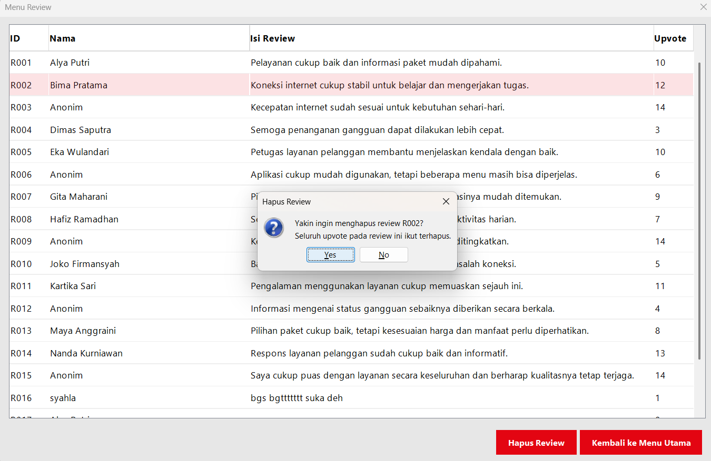


### 8.13 Mengelola Kuesioner

Admin dapat membuat kuesioner baru dengan mengisi judul, deskripsi, dan pertanyaan. Admin juga dapat melihat serta mengubah kuesioner yang sudah tersedia.

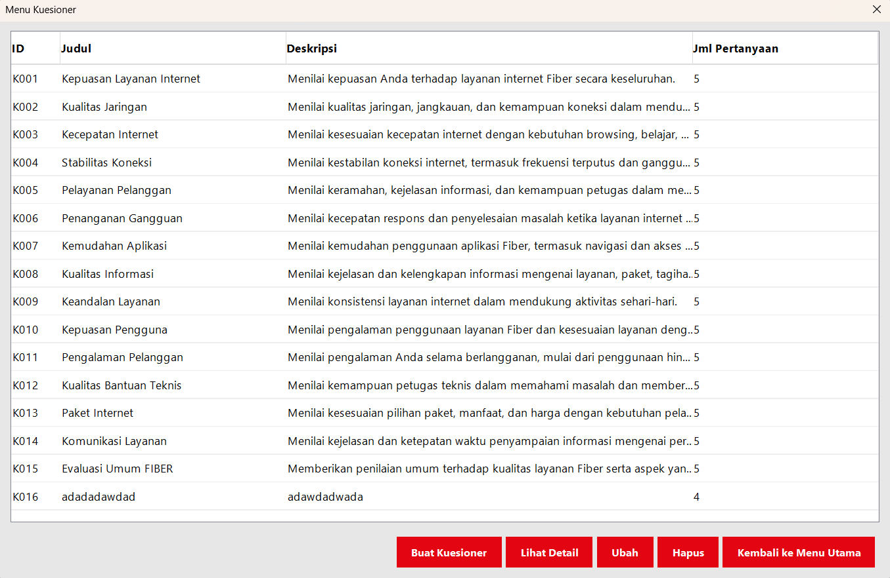

### 8.14 Tambah Kuesioner
Fitur ini digunakan Admin untuk membuat kuesioner baru dengan mengisi judul, deskripsi, dan daftar pertanyaan. Setelah menekan tombol Simpan, data kuesioner akan disimpan ke database dan dapat diakses oleh pelanggan.

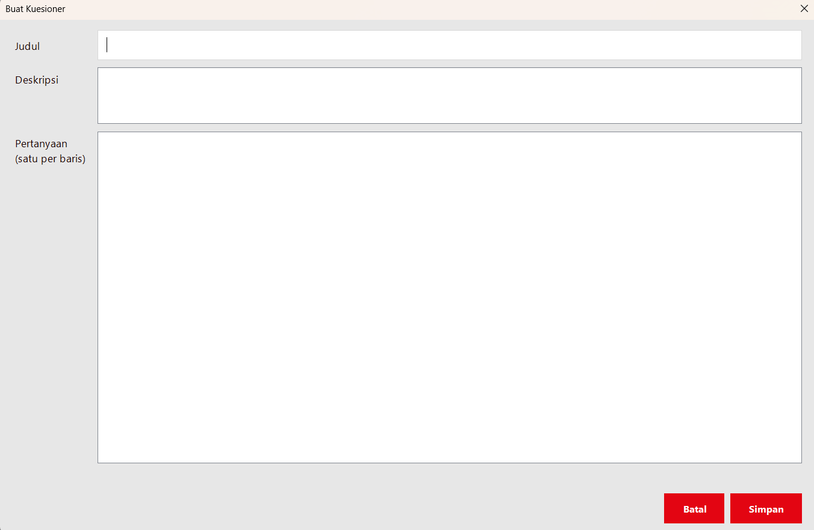

### 8.15 Detail Kuesioner
Fitur ini digunakan Admin untuk melihat informasi lengkap dari kuesioner yang dipilih, termasuk judul, deskripsi, dan daftar pertanyaan yang tersedia.

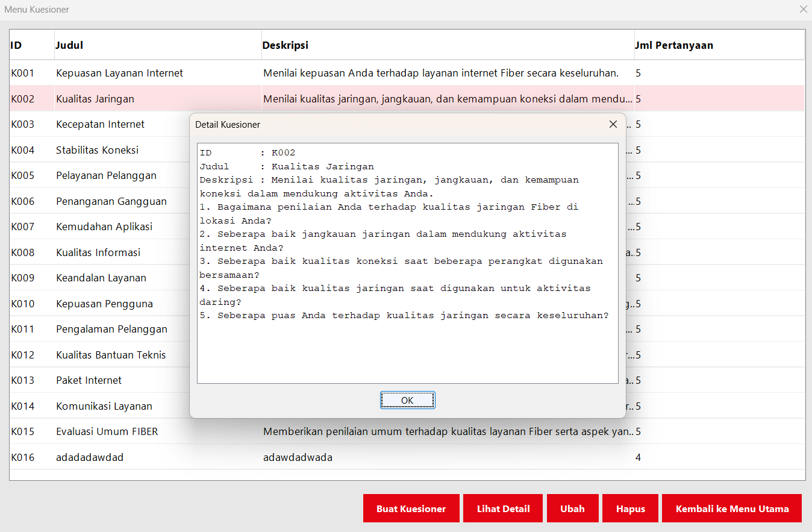

### 8.16 Ubah Kuesioner
Fitur ini digunakan untuk memperbarui informasi kuesioner yang sudah dibuat. Admin dapat memilih kuesioner, kemudian mengubah judul, deskripsi, atau pertanyaan sesuai ketentuan sistem. Setelah selesai, perubahan disimpan kembali ke database.

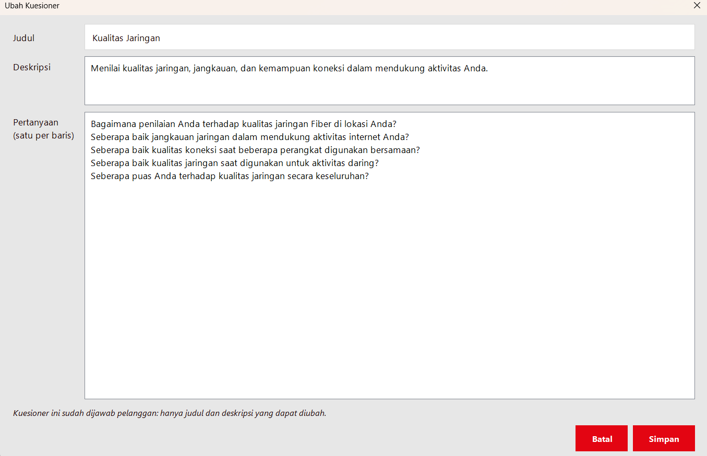

### 8.17 Hapus Kuesioner
Fitur ini digunakan untuk menghapus kuesioner yang sudah tidak diperlukan. Admin memilih kuesioner yang ingin dihapus, kemudian menekan tombol Hapus. Sistem akan menampilkan konfirmasi sebelum data dihapus dari database.

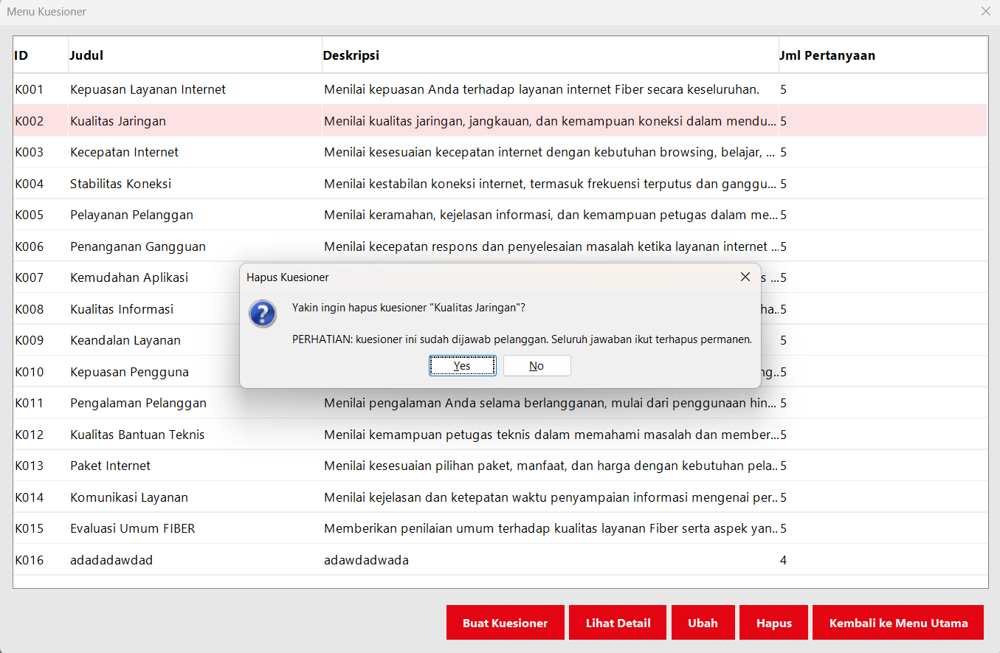


### 8.18 Logout

User maupun Admin dapat keluar dari aplikasi dengan menekan tombol Logout. Sistem akan mengakhiri sesi yang sedang aktif dan mengembalikan pengguna ke halaman login.

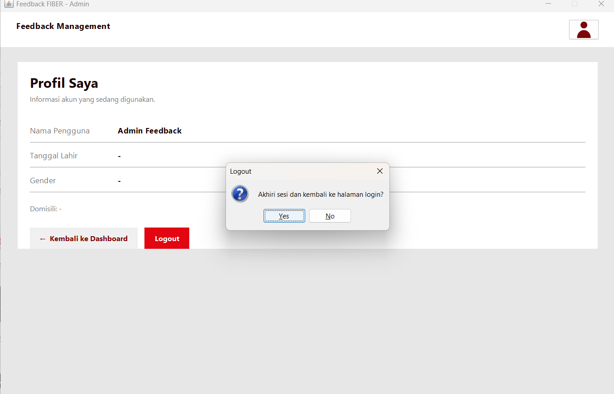


## 9. Kontributor

| No. | Nama | NIM |
|---|---|---|
| 1 | [Antonio Marc Laureno Silaban] | [2509116040] |
| 2 | [Regina Jelita Ningsih] | [2509116061] |
| 3 | [Dliya Syahla Hariyanto] | [2509116095] |
| 4 | [Riko Azkarazendra Russianto] | [2509116104] |

---

**Feedback FIBER**  
Sistem Informasi Pengelolaan Feedback dan Kepuasan Pelanggan FIBER.
